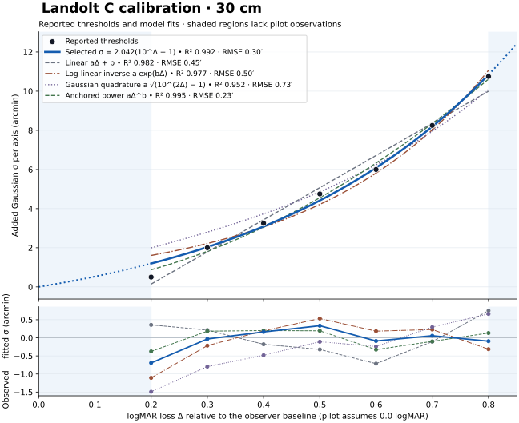

# Phase 13B Gaussian calibration and Acuity-derived integration

## 背景

Leung、Runswick、Heard 與 Rakow（2026）讓 37 名受試者在距螢幕 1 m 的條件下辨識 tumbling E，量測不同 Gaussian σ 下相對於未模糊基線的視力變化。三種螢幕的混合效應回歸採對數線性關係與受試者隨機截距，合併模型解釋逾九成變異。這裡沿用「以受試者基線定義視力劣化，再反算 σ」的做法。其以螢幕像素擬合的係數來自不同視標、觀看距離和判分流程，本專案使用角分與 30 cm Landolt C 閾值重新擬合。 [Leung et al. (2026)](https://doi.org/10.1080/10447318.2026.2664698) · [作者定稿全文](https://kclpure.kcl.ac.uk/ws/portalfiles/portal/374397810/IJHCI_Manuscript_PURE.pdf)

Coppens 與 van den Berg（2004）用 Landolt C 與角度 Gaussian σ 量測健康觀察者，發現最小解析角（MAR）與等效模糊近似成比例，比例有個體差異。McAnany 等（2011）的 tumbling E 研究將外加與內在 Gaussian 模糊的變異數相加，提供一個可比較的非線性模型。本次的 MAR 增量線性式是一項經驗近似。 [Coppens & van den Berg (2004)](https://pubmed.ncbi.nlm.nih.gov/14992839/) · [McAnany et al. (2011)](https://pmc.ncbi.nlm.nih.gov/articles/PMC3100362/)

## 方法

[原始資料](../optics/calibration/landolt-c.json) 是一名健康參考觀察者的一組手動紀錄，共七個視標大小。每筆 σ 是開始無法清楚辨識 Landolt C 缺口方向時的畫面讀值，使用者確認主讀值為各軸的 Gaussian standard deviation，單位 **arcmin**。校準頁以眼到螢幕 30 cm 固定換算，共用 53.98 mm 信用卡短邊的 display calibration。裝置型號、匹配像素值、DPR、zoom、亮度與矯正條件未提供。資料將這些條件留作未記錄。0.0 logMAR 是指定的未模糊基線假設，0.0 的零模糊點沒有作為額外觀測列入擬合。 [校準頁幾何與取樣](phase13-acuity-calibration.md)

各 session 以 `Δ = logMAR(C) − logMAR(baseline)` 計算劣化。候選模型對角度 σ 等權最小平方擬合，直接最小化 app 要預測的量。R² 以原始 σ 的平均值為比較基準，RMSE 與殘差單位皆為 arcmin。逐點留一（LOO）每次用其餘六筆重新擬合，評估單點影響。

## 結果

| 視標 logMAR | 觀察 σ（arcmin） | 最終模型殘差（觀察減預測，arcmin） |
| ---: | ---: | ---: |
| 0.2 | 0.50 | −0.69 |
| 0.3 | 2.00 | −0.03 |
| 0.4 | 3.25 | +0.16 |
| 0.5 | 4.75 | +0.33 |
| 0.6 | 6.00 | −0.09 |
| 0.7 | 8.25 | +0.06 |
| 0.8 | 10.75 | −0.09 |



| 模型 | σ（arcmin） | 擬合係數 | R² | RMSE | LOO RMSE |
| --- | --- | --- | ---: | ---: | ---: |
| 線性 | aΔ + b | a = 16.42857, b = −3.14286 | 0.981903 | 0.4461 | 0.7032 |
| 對數線性反算（參考 Leung） | a exp(bΔ) | a = 0.84473, b = 3.21559 | 0.976890 | 0.5041 | 0.7679 |
| Gaussian 變異數相加 | a√(10^(2Δ) − 1) | a = 1.61952 | 0.952130 | 0.7255 | 0.8196 |
| 零點錨定冪次 | aΔ^b | a = 15.86481, b = 1.79968 | 0.994981 | 0.2349 | 0.3241 |
| **MAR 增量** | **a(10^Δ − 1)** | **a = 2.042217051** | **0.991670** | **0.3026** | **0.3149** |

採用 MAR 增量模型。單一係數讓 σ 隨解析角增加，Δ = 0 時正好為零，且可用 `Δ = log10(1 + σ/a)` 反算。兩參數冪次模型的樣本內 RMSE 較低，逐點留一 RMSE 則接近。線性與無錨點指數分別在基線給出負 σ 與正 σ。Gaussian 變異數相加模型對低端有較大的系統性高估。所採模型對 0.2 的預測為 1.19 arcmin，比觀察值 0.50 高 0.69 arcmin，其他六個殘差的絕對值均小於 0.34 arcmin。

## 程式整合

近物的有效 defocus 為 `−1 / d − R`，遠景為 `−R`，其中 `d` 是模擬物距（m），`R` 是所選側的 target refraction。每側獨立從該 IOL 的臨床曲線取得目標 logMAR。實測節點、節點間的 logMAR 線性內插，以及 SN60WF、DFT015 到 −4 D 的近端外插均沿用 [Phase 13 臨床曲線規則](phase13-clinical-defocus-curves.md)。畫面 decimal VA 仍由臨床曲線的目標 logMAR 以 `10^(−logMAR)` 換算。

從 [版本化模型](../src/lib/data/gaussian-calibration.json) 讀取參考基線和係數，使用 `Δ = max(0, 目標 logMAR − 0.0)` 與 **`σ = 2.042217051 × (10^Δ − 1) arcmin`**。0 < Δ < 0.2 與 Δ > 0.8 使用同一式平滑外推。現有鏡片的最大支援查詢值約 0.8233 logMAR（SN60WF 的有效 −4 D），換算 σ 約 11.55 arcmin。這項 Gaussian 校準外推與臨床 defocus 外插是兩個獨立步驟。

校準頁和主程式以 `σpx = σarcmin × π/10800 × 觀看距離(mm) × render px/mm` 換算。信用卡比例與視窗縮放提供物理像素尺度，X、Y 分別用其實際的渲染密度。校準頁在原生顯示網格濾波，主程式依可用的渲染網格取樣。兩者均使用截斷至各軸 ±4σ 的正規化離散權重，濾波作用於顯示編碼值。主程式用 WebGL 線性取樣合併相鄰 tap，σ 以 0.05 texel 量化。大 σ 由方差相加分成多次卷積。零或極小 σ 直接使用原影像。遠景先投影至實際 viewport 再濾波，因此手機直向裁切會使用同一角度尺度。近物保留原卡片物理比例，濾波後以預乘 alpha 合成；可見畫面邊界使用邊緣樣本延伸。遠景投影和濾波結果可沿滑桿重用。

## 限制

- 七個觀察點來自同一名參考觀察者，且每級僅記錄一個自報閾值。LOO 檢查的是這組資料的單點敏感性，跨受試者和跨裝置的預測誤差仍未知。基線與最小 σ 對 0.2 logMAR 點影響尤其大，裝置的像素取樣也會影響較小缺口的可辨識性。
- 30 cm 與信用卡匹配提供幾何尺度。調節、矯正、環境光、顯示 gamma、實際亮度和瀏覽器呈現仍能改變對比或辨識閾值。Gaussian σ 表示等效的視標辨識模糊。IOL 的真實 PSF、色差、光暈及眩光需靠相應的物理模型或臨床資料評估。 [Johnson & Casson (1995)](https://pubmed.ncbi.nlm.nih.gov/8749333/)
- 後續獨立量測應保存每名觀察者的未模糊視力、裝置校正和重複試次。比較不同裝置或使用群體估計時，可用受試者層級驗證，並比較缺口辨識固定正確率下的閾值。

## 重現與臨床來源

在專案根目錄執行以下指令，重新產生 JSON 與圖。原始資料以 session 收納，可附上不同裝置及同一 logMAR 的重複量測。未來加入 session 後，同一指令會輸出所有候選式係數、R²、RMSE、LOO RMSE 與逐點殘差。

```powershell
uv run --project optics --locked --extra calibration python optics/fit_gaussian_calibration.py
```

- **SN60AT**。FINEVISION HP 美國試驗的單焦對照組，Best-Case Set，第 4 次訪視。 [FDA Figure 5，n = 88](https://www.accessdata.fda.gov/cdrh_docs/pdf24/P240038D.pdf#page=29)
- **SN60WF** 與 **Vivity DFT015**。Vivity 美國隨機試驗術後 6 個月，圖中分別為 111 與 106 名受試者。 [FDA Figure 9](https://www.accessdata.fda.gov/cdrh_docs/pdf/P930014S126B.pdf#page=45) · [美國試驗論文](https://pmc.ncbi.nlm.nih.gov/articles/PMC9622364/)

## 驗證

Chromium 與 WebKit 的 iPhone 13 模擬核對單畫面、分割比較、三款 IOL、左右 target refraction、模式切換與重新校正後的 X/Y 像素 σ。Chromium 的 WebGL 實際讀回涵蓋直向裁切背景、卡片邊緣、不同的左右 σ，以及大 σ 多次卷積。與 CPU 參考卷積比較的最大差低於 2 個顯示編碼階。Physics-based 的 WebGL2、停用 WebGL2 時的 CPU 回退，以及九組 WebGL2／CPU／Python 光學參考均通過。

同機桌面 Chromium 的 iPhone 13 模擬與 Phase 13 末版比較。空快取且限制為 500 kB/s、70 ms 延遲時，5 次 Physics-based 含背景首幀的中位數由 2.846 s 至 2.842 s。暖機後 Acuity-derived 重播 2.7 至 3.9 D，單畫面輸入至提交的 p95 由 18.3 ms 至 20.0 ms，分割由 24.4 ms 至 19.1 ms。兩版使用各自的曲線與渲染，以比較實際操作。這些數字量到瀏覽器提交，實機觸控、合成與螢幕更新仍需手機驗收。
